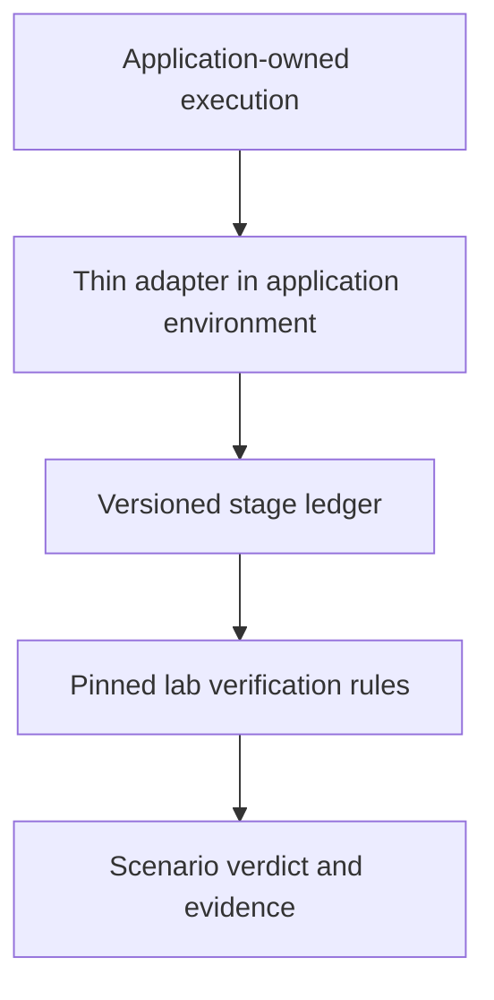

# 🦅 Bald Eagle Lab

**Know what works. Prove every move.**

An open research and verification lab for **document analysis, migration testing, and modular application design**. Develop reusable methods, isolate failures, and carry proven solutions into document applications while each application retains its own unique engine and data.

## 🌐 Current website · v0.1.0 · Build 1

**[Open Bald Eagle Lab](https://sukonik.github.io/baldeaglelab/)** · [🚀 Pages Actions](https://github.com/Sukonik/baldeaglelab/actions/workflows/pages.yml) · [📝 Changelog](CHANGELOG.md) · [🧭 Roadmap](https://sukonik.github.io/baldeaglelab/roadmap.html)

White-and-blue, text-first documentation with restrained Old Glory Red accents. Nine pre-rendered pages, a grouped desktop menu, a mobile navigation drawer, and the **BASE3 UI** format built with React and [Base UI](https://github.com/mui/base-ui).

> **Release scope:** Website Build 1 publishes the project design and documentation. The ledger schema, fixture generator, verdict library, model evaluations, and application adapters are **planned**. A green website workflow is not evidence that document processing or migration works.

## 🎯 Mission

Make document software easier to investigate, test, and improve. Separate dependency readiness from behavioral success; distinguish a useful content-based name from a normalized original name; verify real copies rather than relying on previews.

The lab is designed to support multiple applications and providers through a narrow, versioned evidence contract. Shared methods and verification components can be exported after they are proven. Application-specific pipelines, prompts, interfaces, and private data remain with their applications.

## 🧭 Website directory

| Page                                                                                 | What it covers                                                        | Current status           |
| ------------------------------------------------------------------------------------ | --------------------------------------------------------------------- | ------------------------ |
| [🏠 Overview](https://sukonik.github.io/baldeaglelab/)                               | Mission, framework library, evidence trail, and prospective consumers | Published website        |
| [📄 Document analysis](https://sukonik.github.io/baldeaglelab/analysis.html)         | Inventory, extraction, OCR outcomes, classification, and useful names | Design specification     |
| [📦 Verified migration](https://sukonik.github.io/baldeaglelab/migration.html)       | Approval, normal routing, actual copies, integrity, and recovery      | Design specification     |
| [🧪 Testing & benchmarks](https://sukonik.github.io/baldeaglelab/testing.html)       | Independent expectations, negative controls, and verdicts             | Design specification     |
| [🧠 Models & response contracts](https://sukonik.github.io/baldeaglelab/models.html) | Model provenance, parsing failures, simulated versus live evidence    | Design specification     |
| [🧩 Modular applications](https://sukonik.github.io/baldeaglelab/modules.html)       | Adapter boundaries, reusable components, and pinned exports           | Design specification     |
| [🧾 Stage ledger](https://sukonik.github.io/baldeaglelab/ledger.html)                | Proposed run metadata and per-file fields                             | Draft contract           |
| [🎨 BASE3 UI](https://sukonik.github.io/baldeaglelab/base3.html)                     | Palette, typography, navigation, accessibility, and CSS layers        | Implemented on this site |
| [🗺️ Roadmap & releases](https://sukonik.github.io/baldeaglelab/roadmap.html)         | Build sequence and acceptance gates                                   | Published plan           |

## 🔬 What the lab is designed to handle

### 📄 Document analysis

- Establish a complete input manifest and stable file IDs before processing.
- Separate unique files from attempts, retries, exclusions, and errors.
- Record native extraction, OCR, conversion, and repair outcomes distinctly.
- Compare type, category, and naming concepts against independent expectations.
- Explain the origin of a name and every reason for human review.

### 📦 Migration verification

- Evaluate explicit approvals and expected destination routes.
- Require real copies for migration-success scenarios.
- Compare destination hashes and verify that source hashes remain unchanged.
- Test fallback, quarantine, interruption, collisions, and recovery as separate scenarios.
- Preserve analysis-first workflows; the website does not upload or migrate files.

### 🧪 Repeatable testing

- Use deterministic synthetic fixtures with versioned expected outcomes.
- Produce scenario-specific **PASS**, **FAIL**, or **BLOCKED** verdicts.
- Include deliberately broken cases so tests prove they detect failures.
- Benchmark only after correctness passes, recording environment and cache state.
- Separate repository hygiene, offline contracts, live-model evaluation, and private-corpus evidence.

### 🧠 Model-response contracts

- Record requested, resolved, and actually invoked model identities.
- Distinguish rules, cached responses, simulated output, and real calls.
- Classify malformed JSON, missing types, Unknown values, enum drift, truncation, and timeouts explicitly.
- Keep manual real-Ollama runs outside default public CI.

### 🧩 Modular application building

- Isolate a failure with the smallest useful fixture and stage comparison.
- Develop reusable contracts and verification modules without importing an application's pipeline.
- Export reviewed components through pinned tagged releases after the contract stabilizes.
- Let consumers choose their own execution environment, models, and user interface.

These are the intended harness capabilities. Build 1 implements their documentation, not their execution.

## 🧾 The shared contract: a per-file stage ledger

The lab owns the proposed contract and independent checks. Applications own emitters and adapters. **Schema v1 is not finalized yet.** Field names below are proposals, not a released API.

| Evidence group          | Proposed contents                                                                                                                                                          |
| ----------------------- | -------------------------------------------------------------------------------------------------------------------------------------------------------------------------- |
| Run provenance          | Schema and harness versions, run/scenario IDs, fixture-manifest hash, application commit, installed EXE hash when applicable, operating system, cache state, evidence mode |
| Discovery               | Source ID/hash, discovered/excluded status and reason, processing status, attempts                                                                                         |
| Extraction              | Text length, extraction status, native/OCR/conversion origin, explicit failure                                                                                             |
| Model decision          | Decision tier, model requested/resolved/invoked, response origin, classified parse error                                                                                   |
| Classification & naming | Document type, canonical category, proposed filename, filename origin, confidence                                                                                          |
| Review                  | Review requirement and reasons, sensitivity, migration eligibility                                                                                                         |
| Approval & copy         | Approval status, preview route, actual destination, destination hash, source hash after processing                                                                         |

Count **unique files** separately from **attempts and retries**. Use explicit stage outcomes. Missing evidence never means success. Public examples use synthetic identifiers and paths only; raw text, prompts, and model responses are excluded.

Read the [ledger guide](https://sukonik.github.io/baldeaglelab/ledger.html) before implementing an emitter. Coordinate schema changes with consumer owners before freezing v1.

## 🚦 Evidence and verdict rules

| Situation                                                   | Required interpretation                                       |
| ----------------------------------------------------------- | ------------------------------------------------------------- |
| Zero fixtures or empty ledger in a behavioral run           | FAIL or BLOCKED; never behavioral PASS                        |
| Zero approvals in a migration-success scenario              | BLOCKED; cannot certify migration                             |
| Approved files but zero actual copies                       | FAIL                                                          |
| All names are fallback-only in a content-naming scenario    | FAIL                                                          |
| Only fallback routes in a normal-route scenario             | FAIL                                                          |
| Simulated or cached responses presented as live invocations | FAIL or BLOCKED                                               |
| A test intentionally expects review and no copy             | May PASS that review scenario; does not certify migration     |
| Website build, link checks, or repository hygiene pass      | Website/hygiene success only; application behavior NOT TESTED |

## 🔗 Application boundaries



**BlackBowAI:** prospective consumer for document-analysis and migration verification. Root-cause investigation, application changes, real-Windows comparisons, private adapters, and private-corpus results stay in its own environment.

**[WindSwordAI](https://github.com/Sukonik/windswordai):** prospective consumer of provider-neutral evaluation contracts. Integration is planned. No adapter or certification is asserted by this release.

The public lab never imports private application code. A public repository is not a route for publishing private installer payloads or private test evidence. Initial distribution is planned as a tagged release that consumers pin, not a PyPI service or shared hosted backend.

## 🛡️ Synthetic-only public data

All committed fixtures, examples, logs, and published artifacts must be synthetic. No real municipal, client, or private documents, document bodies, filenames, prompts, paths, or model responses belong here.

See [DATA_POLICY.md](docs/DATA_POLICY.md) for admission rules and the limits of automated scanning. **Fixture admission and PII/secret scanning are planned BE-00 work; they are not implemented by the website checks.**

## 🎨 BASE3 UI architecture

**BASE3** is our project interface format: editorial structure, accessible behavior, and a clear visual foundation. It is not the name of a third-party framework.

| Layer            | Implementation                                                                                                   |
| ---------------- | ---------------------------------------------------------------------------------------------------------------- |
| Foundation       | Semantic HTML, React-rendered pages, shared CSS tokens                                                           |
| Behavior         | [Base UI](https://github.com/mui/base-ui) `Menu` for desktop frameworks and `Dialog` for the mobile drawer       |
| Editorial format | GoldBrief-inspired compact masthead, grouped navigation, geometric headlines, numbered rows, and readable guides |

**Palette:**

| Token          | Hex       | Use                                                     |
| -------------- | --------- | ------------------------------------------------------- |
| Old Glory Blue | `#002868` | Headings, primary navigation, buttons, evidence section |
| White          | `#FFFFFF` | Main canvas and content surfaces                        |
| Old Glory Red  | `#B22234` | Restrained rules, small markers, and accents            |
| Signal Blue    | `#165DDE` | Links, emphasis, and focus outlines                     |
| Pale Blue      | `#F2F6FC` | Supporting surfaces                                     |
| Reading Ink    | `#102B50` | Main text                                               |
| Muted Ink      | `#526580` | Supporting text                                         |

**Typography:** Outfit for wordmark and headings; Inter for reading and interface text; Helvetica/Arial fallbacks. Fonts use Google Fonts with `display=swap`. If fonts are unavailable, the page remains readable with local fallbacks. No analytics, document uploads, or account system.

**CSS layer order:** `tokens` → `base` → `components` → `responsive` → `baldeaglelab`.

**Responsive behavior:** mobile drawer below 1101px, one-column content below 761px, narrow-phone refinements below 381px. CSS Grid and Flexbox handle layout without Bootstrap or Tailwind. The mobile drawer is a modal Base UI Dialog with Escape dismissal, focus containment, and focus return. Links use real page URLs. Core content and footer navigation are pre-rendered and remain readable without JavaScript. Visible focus, a skip link, and reduced-motion support apply throughout.

**Reference:** [GoldBrief website](https://sukonik.github.io/goldbrief/) · [GoldBrief source](https://github.com/Sukonik/goldbrief) · [GoldBrief brand documentation](https://github.com/Sukonik/goldbrief/blob/main/docs/BRAND.md). This is a fresh implementation; GoldBrief's briefcase and black-and-gold identity are not reused.

More: [BASE3 design documentation](docs/BASE3.md) · [Live BASE3 guide](https://sukonik.github.io/baldeaglelab/base3.html).

**🦅 Logo direction:** The current folded-wing icon is provisional. A later flat, 2D eagle-holding-a-folder design will have natural-color, black-and-white, and blue-white-red variants. See the [logo brief](docs/LOGO_BRIEF.md).

## 🛠️ Local development

Requires **Node.js 22.12+** and npm. The JavaScript dependencies serve the documentation website only. The future verdict library is intended to use the Python standard library.

```bash
npm ci
npm test             # production build, pre-rendering, website integrity
npm run dev          # preview the built dist/ site; open the printed URL
```

After edits, rerun `npm test` and refresh the preview. Edit guide content in `site/src/data.mjs`, layouts in `site/src/App.jsx`, and styles in `site/src/styles/`.

## 🗂️ Repository layout

```text
.github/workflows/pages.yml   Pull-request checks and Pages deployment
site/src/App.jsx             Shared layout, home, menus, and guide template
site/src/data.mjs            Framework and reference-page content
site/src/client.jsx          React hydration and styles
site/src/styles/             BASE3 CSS layers
site/public/eagle.svg        Folded-wing identity and favicon
scripts/build.mjs           Vite build and nine-page pre-rendering
scripts/check-site.mjs      Website integrity checks
docs/BASE3.md               Design and interaction contract
docs/DATA_POLICY.md         Public synthetic-data boundaries
CHANGELOG.md                Release history
```

## ✅ Website verification

`npm test` checks that all nine pages build, each has one h1, unique IDs, a skip link, canonical metadata, pre-rendered guide text, and working local references. It checks project-relative asset paths and a 400,000-byte JavaScript bundle budget.

Manual browser review should cover desktop and phone layouts, framework-menu navigation, drawer dismissal and focus return, visible focus, and reduced motion. Static checks do not prove layout correctness or full accessibility conformance. Application extraction, naming, model behavior, and migration remain **NOT TESTED** by these checks.

## 🚀 GitHub Pages deployment

[`.github/workflows/pages.yml`](.github/workflows/pages.yml) builds on pull requests and pushes to `main`; `workflow_dispatch` permits manual reruns. Pull requests run website checks only. Main-branch and manual runs upload **only `dist/`** and deploy through the `github-pages` environment using GitHub's Pages artifact and deployment actions.

Pages source must be **GitHub Actions**, as configured in repository Settings → Pages. Build dependencies are locked in `package-lock.json`. Deployment grants Pages write and OIDC permissions only to the deploy job; default repository permission is contents read.

Standard hosted-runner usage for public repositories is free, but time, concurrency, storage, and policy limits still apply. A private caller of a public reusable workflow uses the caller's billing context. See [GitHub billing and usage](https://docs.github.com/en/actions/concepts/billing-and-usage) and [Actions limits](https://docs.github.com/en/actions/reference/limits).

## 🗺️ Build roadmap

| Slice           | Deliverable                                                 | Acceptance gate                                                                | Status  |
| --------------- | ----------------------------------------------------------- | ------------------------------------------------------------------------------ | ------- |
| Website Build 1 | README, BASE3, nine-page documentation site, Pages workflow | Website integrity and responsive browser review                                | v0.1.0  |
| BE-00           | Hygiene checks, fixture admission, data-policy enforcement  | Synthetic admission checks and negative controls; no behavioral claim          | Planned |
| BE-01           | Ledger schema and scenario verdict library                  | Known-good passes; empty, invalid, and misleading evidence fails/blocks        | Planned |
| BE-02           | Ten deterministic synthetic documents                       | Regeneration yields identical hashes and expected manifest                     | Planned |
| BE-03           | Offline response-contract tests                             | Malformed/missing/Unknown/drift/truncation/timeout cases yield explicit errors | Planned |
| BE-04           | Manual local or self-hosted real-Ollama evaluation          | Invocation provenance, real/simulated separation, excluded from default CI     | Planned |
| BE-05           | First pinned export and application adapter                 | Stable ledger and controlled application comparison before export              | Planned |

No installers, production-pipeline rewrites, private-corpus publishing, or application feature work are included in Website Build 1. The Ubuntu website build runner does not resume Linux application certification work.

## 🤝 Contributing

Open a focused issue with the problem, synthetic reproduction, independent expected result, and a proposed acceptance gate. Keep pull requests small and scoped to one slice. Report what changed, checks and results, what remains unverified, and any ledger field changes consumers need to know about.

Never paste private documents, private filenames, prompts, paths, logs, or model responses into a public issue. Fixture provenance is required before adding any test document; a scanner is not a substitute for review.

## 📜 License

This repository retains [Mozilla Public License 2.0](LICENSE). Third-party dependencies retain their respective licenses; see [THIRD_PARTY.md](docs/THIRD_PARTY.md). No license change is made in this release.

## 🕰️ Website version history

| Version             | Date           | Scope                                                                                   |
| ------------------- | -------------- | --------------------------------------------------------------------------------------- |
| **0.1.0 · Build 1** | **2026-11-04** | First documentation website: BASE3, nine pages, comprehensive README, and Pages Actions |
| Initial repository  | 2026-11-04     | License and short project description                                                   |

When a user-visible website change ships, update the version, this history, and [CHANGELOG.md](CHANGELOG.md). Harness releases will have their own evidence and must not inherit certification from website version numbers.
