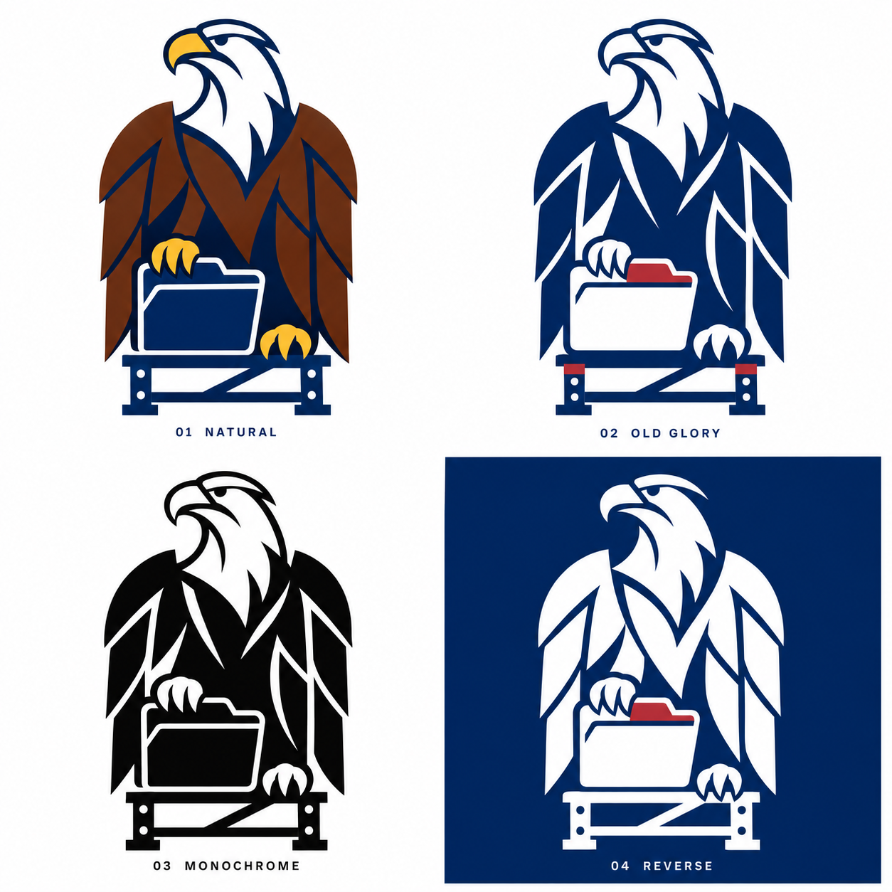

# Bald Eagle Lab · V1 icon collection

The owner approved all four directions on the V1 comparison board on November 4, 2026 and requested separate GitHub assets plus a blue version of the monochrome design.

## Individual assets

| Variant | PNG | Background | Status |
| --- | --- | --- | --- |
| Natural | [Download](../site/public/brand/v1/baldeaglelab-natural-v1.png) | Transparent outside the emblem; white head and neck retained | Approved V1 direction |
| Old Glory | [Download](../site/public/brand/v1/baldeaglelab-old-glory-v1.png) | Transparent outside the emblem; white details retained | Approved V1 direction |
| Black Monochrome | [Download](../site/public/brand/v1/baldeaglelab-monochrome-black-v1.png) | Transparent outside the emblem; white details retained | Approved V1 direction |
| Reverse | [Download](../site/public/brand/v1/baldeaglelab-reverse-v1.png) | Navy square | Approved V1 direction |
| Blue Monochrome | [Download](../site/public/brand/v1/baldeaglelab-monochrome-blue-v1.png) | White square | Additional requested color preview |

Every file is standalone and has no comparison label. The [manifest](../site/public/brand/v1/manifest.json) records dimensions, alpha ranges, file sizes, and SHA-256 hashes. Public assets are copied into the Pages build under `brand/v1/`.

## Visual reference

The original board remains the authoritative approved visual reference. Standalone PNGs were generated from it through the built-in image tool; they are raster editions and may have small geometric differences. They are not exact cropped vector masters. No source reference photograph is included.

## Composition and color

- Upright eagle with a left-facing head and downward folded wings.
- One talon grips a document folder; the other rests on a straight industrial scaffold.
- Natural: white head/neck, yellow beak and feet, brown body, navy folder and scaffold.
- Old Glory: navy and white, with restrained red accents.
- Black Monochrome: black and white.
- Reverse: white emblem on navy, with a small red folder tab.
- Blue Monochrome: the black design translated to navy and white, without red, yellow, or brown.

Target brand tokens are Old Glory Blue `#002868`, White `#FFFFFF`, and Old Glory Red `#B22234`. Raster pixels include antialiasing and generated color variation; use the CSS tokens for exact interface colors. Production vector work should use solid fills without gradients or texture.

## Use and next refinement

Preserve aspect ratio, keep clear space, and retain the folder and scaffold. Use the reverse asset on dark surfaces. Do not erase white interior shapes when preparing transparency. Do not relabel the generated PNGs as SVG or claim they are production vector files.

The website's initial folded-wing favicon remains provisional while the detailed eagle receives small-size review. Exact vector construction and simplified 24/32/64px variants are future production work, not included in this asset-only update.
